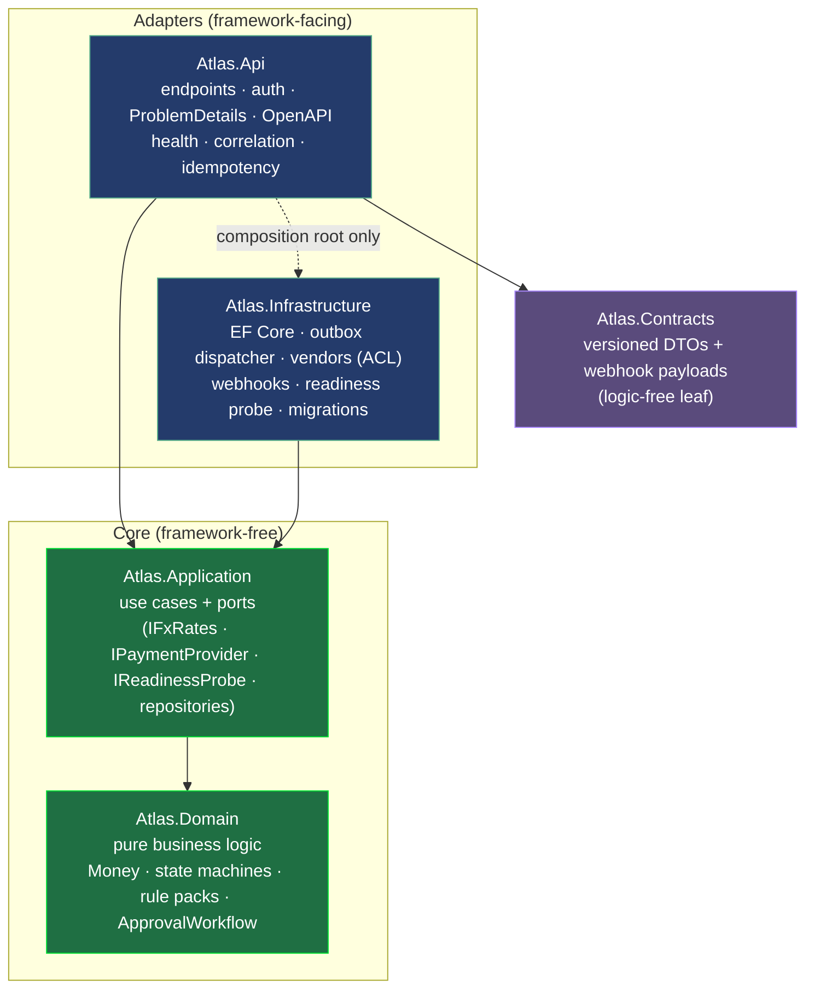

# Course Retrospective — Atlas, Fifteen Sprints

> Reading your own course critically is the last skill it teaches. This is how a senior extracts
> lessons from a finished body of work: what the design bought, where it held, where it bent, and
> what is still owed. The thesis is adjudicated with numbers, not adjectives.

*(Naming note: the S15 playbook calls this `COURSE-RETROSPECTIVE.md`; the S15 brief called it
`docs/retrospective.md`. One file, two names — see `meta/NOTES.md`. Content is identical either way.)*

## The thesis, and the verdict

> **Software is optimized for change.**

Fifteen sprints existed to answer one question mechanically: *when the business rules change — and in
global employment they change constantly — how small is the diff?* The verdict is **earned, not
claimed**, on two exhibits:

- **S11 — countries as plugins.** Two new countries (JPN, which needed a *code-level* conditional
  rule; CAN, pure data) were added as **rule-pack files only**, with `git diff --stat` in the PR body
  showing **zero core-code changes**. The open-closed principle, with receipts.
- **S12 — the pivot exam.** A real mid-quarter requirement (a second payroll vendor, LedgerPay, with
  clients switching mid-quarter) landed cold. The PR carried a **files-touched-per-layer table**. The
  diff concentrated in the edges (a new vendor adapter, an effective-dated `VendorAssignment`, a v2
  payslip shape) and left the **domain calculator and the twenty event call sites untouched**. The
  S01 Reviewer's conditional concession — *"if S12's diff isn't local, I was right"* — was collected
  by the Author, with data.

The honest footnote: locality is not free and did not hold everywhere (below). But the mechanism that
made the pivot cheap — pure Domain, ports for volatility, fitness tests holding the boundary — did
what it was designed to do, and you can check the diffs yourself.

## What the architecture bought

- **The hexagon as executable rules (S01).** `Atlas.ArchitectureTests` failed the build on a
  dependency-rule violation from Sprint 1. The boundary was never a diagram to argue about; it was a
  gate. That is why the Domain stayed framework-free for fifteen sprints and the S12 pivot could trust
  it.
- **Ports earn rent later (S04 → S12).** `IFxRates` and later `IPaymentCalculationVendor` looked like
  ceremony when introduced. The pivot invoiced the difference: swapping/adding a vendor was an adapter,
  not a rewrite. Same story with `IEventSink` (S05) becoming the outbox (S10) with **zero call-site
  changes**.
- **Fitness functions catch what review misses.** The ambient-time BAN test (S06) harvested flaw #2 by
  scanning source for `DateTime.Now` — and it will fail forever, on the next reoccurrence too. The
  strongest test in the course is the one that bans a *pattern*, not an *example*.
- **Idempotency as a design input, not a retrofit (S07 → S10).** Payroll's natural-key guard was
  built idempotent in S07; the `Idempotency-Key` middleware generalized it to every money-moving POST
  in S10. When the double-pay window (flaw #3) surfaced, the fix slotted into a shape already there.

## Sprint-by-sprint, one lesson each

| S | Headline | The lesson to keep |
|---|---|---|
| 01 | Walking skeleton | Carry conventions (pagination, ProblemDetails, OpenAPI drift, arch tests) *before* features. |
| 02 | AuthN/Z, tenancy | Multi-tenant from day one; every query tenant-scoped — the one you forget is flaw #5. |
| 03 | Workers, effective dating | Salary history is never overwritten. (Planted flaws #2 and #5 here.) |
| 04 | Quotes, Money, rule packs | Value objects are bug repellent; policy-as-data until a country needs code. (Planted #1.) |
| 05 | Hiring state machine → v0.5.0 | Explicit states beat boolean soup. (Planted #4: publish-before-commit.) |
| 06 | Time off | The clock is a dependency. (Harvested #2 with a source-scan fitness test.) |
| 07 | Payroll engine | Composition of everything prior into one auditable calculation; idempotent by design. |
| 08 | Expenses + Approval extraction | Rule of three, honestly applied at two: extract when the *second* consumer proves the shape. |
| 09 | Contractor invoicing + ACL | The anti-corruption layer is where a vendor's dialect stops. (Planted #3.) |
| 10 | Integration surface | At-least-once + idempotent consumers is the contract. (Harvested #3 and #4 in one PR.) |
| 11 | Rule packs as plugins | Open-closed with receipts: two countries, zero core changes. |
| 12 | The pivot exam | Contract evolution without breakage; the thesis adjudicated with a locality table. |
| 13 | Security hardening | Make the wrong thing unrepresentable > remember to filter. (Harvested #1 and #5.) |
| 14 | Reporting & performance | Query shape ≠ object shape; measure before optimizing; caching is a liability you document first. |
| 15 | Production readiness | Operations as a design review you can't argue with; the honest accounting (this file + the ledger). |

## The cross-sprint arcs

- **Money (S04 → S07 → S13).** `Money` as a value object; largest-remainder allocation so payslip
  lines sum to the total; then the S13 audit deleting the `double` FX fast path (flaw #1) — a
  precision bug that only bites at payroll scale. *Lesson: exactness is a type's job; a "fast path"
  that leaves the type is a bug with a flattering name.*
- **The clock (S03 → S06).** From convenient `DateTime.Now` to `TimeProvider`/`IClock` + `DateOnly`
  semantics, forced by a PHL-worker/US-server bug (flaw #2). *Lesson: ambient time is a correctness
  bug in any system that spans time zones.*
- **Approval (S06 → S08 → S09).** A concrete leave-approval flow, copy-pasted (on purpose) for
  expenses, then extracted into `ApprovalWorkflow<T>` when the *second* consumer proved the shape —
  and a two-step variant for invoices. *Lesson: today's duplication is tomorrow's specification;
  extract on evidence, not prediction.*
- **Events leaving the system (S05 → S09 → S10).** Activity rows → notifications → the transactional
  outbox. The publish-before-commit ordering (flaw #4) went from latent bug to *correct* when the
  seam's meaning changed under twenty unchanged callers. *Lesson: you cannot atomically update two
  systems; the outbox is the honest third option.*
- **Rule packs (S04 → S11 → S12).** Data tables → plugin classes → the pivot exam. The S04 Reviewer
  predicted the data-table "collapse" when a country needed a conditional; S11's JPN pack paid that
  bet exactly as ADR-0005 scheduled. *Lesson: name the promotion trigger when you take the bet, and
  the payoff is a scheduled event, not a scramble.*

## The debates: the Reviewer's three wins

The course tracked design debates where `[Reviewer]` challenged a real decision and, three times, won
a change of course (S12's PR body explicitly collects *"the third"*):

1. **S07 — the parameter object.** Reviewer lost the main point (the calculator stays a pure function,
   not a DI'd class) but won a real one: a `PayrollCalculationInput` parameter object collapsed a
   five-argument signature. Follow-up commit shipped.
2. **S11 — the override ledger.** Reviewer accepted per-country gross-to-net hook overrides *on the
   condition* that a `docs/` table records which countries override which hooks (an auditor must not
   read N files to know). Added.
3. **S12 — shadow-run gating + redaction.** Reviewer won on both counts: shadow runs are time-boxed
   per org (allowlist + auto-expiry after flip), and comparison reports redact net-pay values to
   deltas. Both landed in the pivot PR. *The course's third Reviewer win.*

A fourth is worth noting for honesty: **S13 — belt and suspenders.** The Reviewer's global EF query
filter *and* the Author's typed `OrgScopedId` both shipped, with the outbox dispatcher documented as
the deliberate org-less exception. And the arc closed where it opened: the **S15** debate (log-based
metrics vs OpenTelemetry) ended the way S01's did — the Author held the *when*, conceded the
*destination*, and the `IMetrics` port made "swapping it is a local diff" a checkable fact. *The
course's last debate ends the way its first did: with the diff as the argument.*

## The flaw ledger's verdict

Five flaws, planted silently, all harvested with RED→GREEN arcs and pinned regression tests. Full
accounting in [`sprints/flaw-ledger.md`](sprints/flaw-ledger.md). The meta-lesson: **every flaw
survived review because the code next to it was genuinely good.** The transferable skill is to feel
the pull of the interesting code and deliberately audit its dull neighbor. That habit is the whole
course, compressed into five bugs.

## Honest debts still open

A retrospective that lists only wins is marketing. What Atlas knowingly still owes:

1. **Correlation ends at the request (S15).** The correlation id threads a single HTTP request's
   logs, but does not yet ride the `OutboxMessage` row into webhook delivery — so "trace one business
   event from request to partner" is a column + migration away, named in ADR-0018, not shipped.
2. **Single in-process outbox dispatcher.** Fine at course scale; the S15 stall drill demonstrated the
   single-process amplifier. The ADR-0011 migration trigger (LISTEN/NOTIFY or a broker for multi-node)
   is real and now has evidence behind it.
3. **Webhook secrets stored readable.** We must sign with them, so they are plaintext at rest; a
   leaked table forges deliveries. Production envelope-encrypts (KMS). Named in ADR-0011 and the S13
   threat model; the mitigation until then is rotation (`runbooks/rotate-secrets.md`).
4. **No per-endpoint webhook auto-redrive.** Failed deliveries are redelivered by hand (S10 deferral).
   A second drain over `WebhookDelivery` is the straightforward follow-up.
5. **Metrics are log lines.** Deliberate (ADR-0018), but the ceiling — real metrics infra — is
   unbuilt. The port exists; the adapter does not.
6. **Domain fidelity is shape, not rates.** Country rules are realistic in *shape*, simplified in
   *rates* (ADR-0000). This is a software-design curriculum, not a payroll-compliance reference.

Naming a debt is the senior move; pretending it is done is the junior one.

## Further-exercise syllabus (write Sprint 16 yourself)

The best exercise the course can leave you is to extend it and measure the locality of your own diff:

- **Thread the correlation id request → outbox → webhook.** One column, one migration, one delivery
  change. Which layer takes the most diff? Was it the right one?
- **Add a third payroll vendor.** Time yourself; count files per layer. Compare to S12's table. Did the
  port hold?
- **Build the per-endpoint webhook auto-redrive** as a second drain over `WebhookDelivery`. What does
  the outbox pattern hand you for free?
- **Swap `LoggingMetrics` for an OpenTelemetry adapter.** Is it really the S12-grade one-file diff the
  debate promised? Prove it or falsify it.
- **Add a country with a code-bearing rule** using only pack files. Attach your own `diff --stat`.
  Zero core? If not, why not — and is that the domain's real shape talking?

## The architecture, one diagram

Dependencies point **inward**: `Domain ← Application ← Infrastructure/Api`, with `Contracts` a
logic-free leaf referenced only by `Api`. The arrows are not a wish — `Atlas.ArchitectureTests`
fails the build if one points the wrong way. That gate, armed in Sprint 1, is why everything above it
was possible.

— **v1.0.0.** The product is real; the way it was built was the point.
